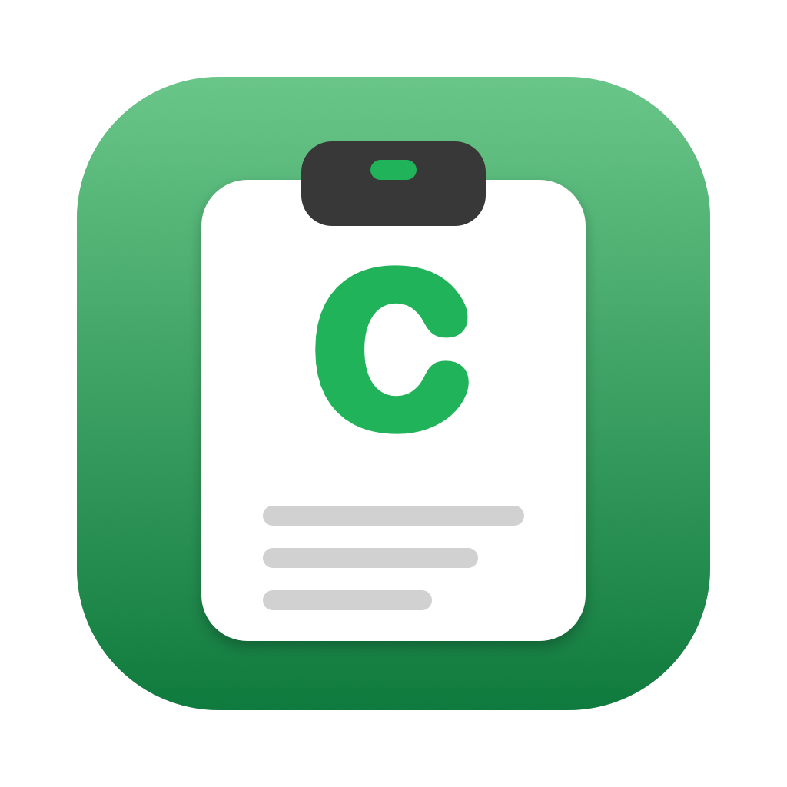
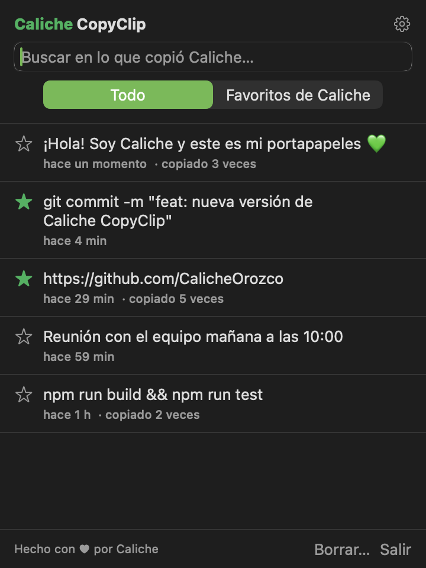
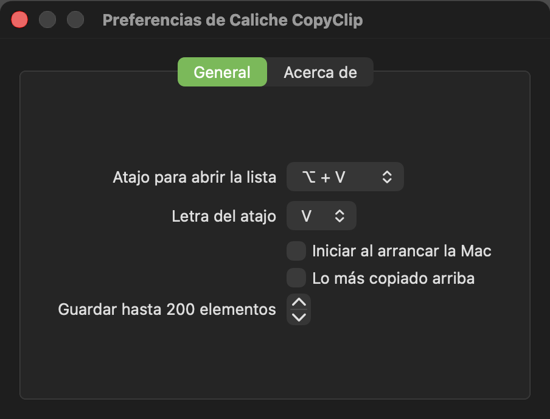
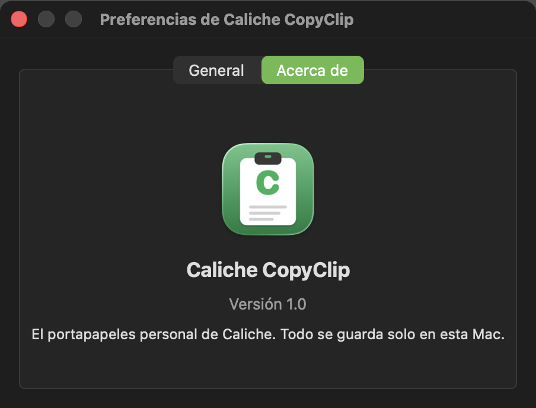

<p align="center">
  
</p>

# Caliche CopyClip

El portapapeles personal de Caliche: una app de barra de menú para macOS que guarda el historial de texto que copias para usarlo después.

Es una app nueva escrita desde cero en Swift, inspirada en las funciones básicas de CopyClip. No contiene código, íconos ni recursos de CopyClip.

<p align="center">
  
</p>

## Funciones

- Vive en la barra de menú (ícono de portapapeles), sin ícono en el Dock.
- Guarda el historial de todo el texto que copias.
- Clic en un elemento para copiarlo otra vez y pegarlo con ⌘V.
- Favoritos con estrella y filtro "Favoritos de Caliche". Los favoritos nunca se borran solos.
- Búsqueda dentro del historial.
- Muestra hace cuánto copiaste cada cosa ("hace 5 min", "hace 2 h").
- Contador de veces copiado y opción "Lo más copiado arriba".
- Borrar un elemento (pasa el mouse y usa el bote de basura), borrar todo o todo excepto favoritos.
- Atajo global para abrir la lista: ⌥V (Opción + V) por defecto, configurable.
- Iniciar al arrancar la Mac.
- Ignora lo que los gestores de contraseñas marcan como oculto o temporal.
- Todo se guarda solo en esta Mac.

## Requisitos

- macOS 13 (Ventura) o más nuevo.
- Xcode o las Command Line Tools de Xcode (para tener `swift`). Si no las tienes:

```bash
xcode-select --install
```

## Instalar

1. Compila la app:

```bash
cd "/Users/calicheorozco/Documents/Web Development/CalicheCopyClip" && ./build.sh
```

2. Cópiala a Aplicaciones:

```bash
cp -R "/Users/calicheorozco/Documents/Web Development/CalicheCopyClip/build/Caliche CopyClip.app" /Applications/
```

3. Ábrela:

```bash
open "/Applications/Caliche CopyClip.app"
```

Si macOS dice que no puede verificar la app, ábrela una vez con clic derecho > Abrir. La app está firmada localmente (ad hoc), no con una cuenta de desarrollador de Apple.

## Recompilar después de un cambio

1. Cierra la app que está corriendo (botón **Salir** en la lista):

```bash
pkill -f "Caliche CopyClip.app/Contents/MacOS/CalicheCopyClip"
```

2. Compila de nuevo:

```bash
cd "/Users/calicheorozco/Documents/Web Development/CalicheCopyClip" && ./build.sh
```

3. Reemplaza la copia instalada y ábrela:

```bash
rm -rf "/Applications/Caliche CopyClip.app" && cp -R "/Users/calicheorozco/Documents/Web Development/CalicheCopyClip/build/Caliche CopyClip.app" /Applications/ && open "/Applications/Caliche CopyClip.app"
```

Tu historial no se pierde al recompilar ni al reinstalar.

## Uso

- Clic en el ícono de la barra de menú, o ⌥V (Opción + V), para abrir la lista.
- Clic en un elemento para copiarlo. Aparece "¡Listo para pegar, Caliche! ⌘V" y la lista se cierra.
- Clic en la estrella para marcarlo como favorito.
- **Borrar…** abre las opciones para borrar todo o todo excepto favoritos.
- El engrane abre las preferencias.

## Preferencias

<p align="center">
  
  
</p>

- **Atajo para abrir la lista:** ⌥ (Opción) o ⌘⇧ (Comando + Mayúsculas), más una letra (V, C, X, K, L o H). Mientras el atajo esté activo, esa combinación ya no escribe su carácter especial (por ejemplo, ⌥V deja de escribir √). Si otra app ya usa ese atajo (por ejemplo, CopyClip original), elige otra combinación.
- **Iniciar al arrancar la Mac:** funciona mejor si la app está en `/Applications`. Si macOS no lo permite, la app muestra el error ahí mismo.
- **Lo más copiado arriba:** ordena por número de veces copiado en vez de por fecha.
- **Guardar hasta N elementos:** al pasar el límite se borran los más viejos que no son favoritos.

## Dónde se guardan los datos

- Historial: `~/Library/Application Support/CalicheCopyClip/history.json`
- Preferencias: `defaults read com.caliche.CalicheCopyClip`

Para empezar de cero, cierra la app y borra el historial:

```bash
rm ~/Library/Application\ Support/CalicheCopyClip/history.json
```

## Desinstalar

```bash
pkill -f "Caliche CopyClip.app/Contents/MacOS/CalicheCopyClip"; rm -rf "/Applications/Caliche CopyClip.app" ~/Library/Application\ Support/CalicheCopyClip && defaults delete com.caliche.CalicheCopyClip
```

## Actualizar las capturas

Las capturas de `docs/` se generan en modo oscuro con datos de ejemplo, sin tocar tu historial real. La app se dibuja a sí misma, así que no necesita permiso de Grabación de pantalla. La app sigue el modo claro u oscuro de tu Mac; solo las capturas son siempre oscuras:

```bash
cd "/Users/calicheorozco/Documents/Web Development/CalicheCopyClip" && ./build.sh && open -n "build/Caliche CopyClip.app" --args --demo --snapshot "$PWD/docs"
```

Cierra antes la app normal si usa el mismo atajo. La app de demostración se cierra sola después de unos segundos.

## Cambiar el logo

El logo (un portapapeles con la "C" de Caliche en verde) se dibuja con código en `scripts/make-icon.swift`. Si lo editas, vuelve a generarlo y recompila:

```bash
cd "/Users/calicheorozco/Documents/Web Development/CalicheCopyClip" && swift scripts/make-icon.swift . && ./build.sh
```

Esto actualiza `Resources/AppIcon.icns` (el ícono de la app) y `docs/icono.png` (la imagen del README). Si Finder sigue mostrando el ícono viejo, cierra y vuelve a abrir la ventana de Finder.

## Estructura del proyecto

| Archivo | Qué hace |
|---|---|
| `Sources/CalicheCopyClip/main.swift` | Arranque, ícono de la barra de menú, ventana de preferencias y modo de capturas |
| `Sources/CalicheCopyClip/ClipStore.swift` | Historial: vigila el portapapeles, guarda en disco, favoritos y límites |
| `Sources/CalicheCopyClip/HistoryView.swift` | La lista, la búsqueda y el color verde de Caliche (`Color.caliche`) |
| `Sources/CalicheCopyClip/SettingsView.swift` | Preferencias y "Acerca de" |
| `Sources/CalicheCopyClip/HotKey.swift` | Atajo global (⌥ o ⌘⇧ + letra) |
| `scripts/make-icon.swift` | Dibuja el logo y genera `Resources/AppIcon.icns` |
| `Info.plist` | Nombre, identificador (`com.caliche.CalicheCopyClip`) y versión |
| `build.sh` | Compila y arma `build/Caliche CopyClip.app` |

Para cambiar el color, edita `Color.caliche` en `HistoryView.swift`. Para subir la versión, edita `CFBundleShortVersionString` en `Info.plist`.
